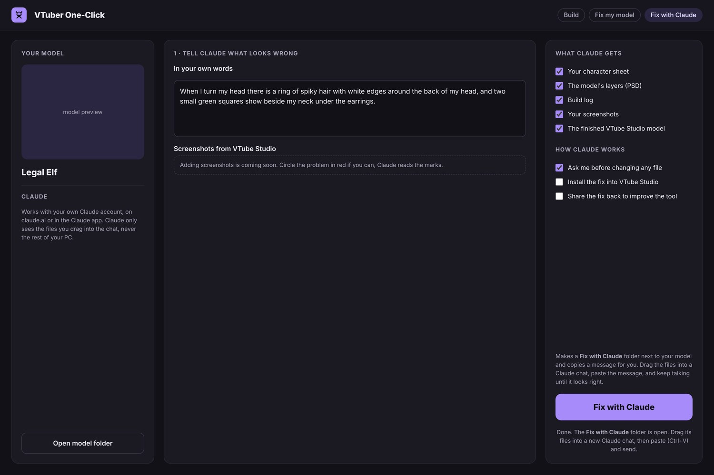

# How to fix your VTuber model with Claude

If your model looks wrong, the app's **Fix with Claude** button packs everything Claude needs into one folder and
writes your first message for you. You just drag and paste.

## What you need

- **VTuber One-Click 0.3.1 or newer.** If the button is greyed out and says "Coming soon", reinstall with the newest Setup.exe.
- **A finished model.** Fix with Claude always works on your newest build.
- **A Claude account.** Any plan works, including free. Use [claude.ai](https://claude.ai) in your browser or the Claude app.
- **About 5 minutes** to set it up, then as long as the chat takes.

## Step by step

1. Open **VTuber One-Click** from your Desktop and click the **Fix with Claude** tab (top right).
2. Under **Tell Claude what looks wrong**, describe the problem in your own words (see the tips below).
3. Under **What Claude gets**, leave every box ticked unless you have a reason not to.
4. Click the purple **Fix with Claude** button.
   - A **Fix with Claude** folder opens. It is saved in your model's build folder.
   - Your first message to Claude is copied for you.
5. Open a **new chat** at [claude.ai](https://claude.ai) or in the Claude app.
6. Select **all the files** in the Fix with Claude folder (Ctrl+A) and drag them into the chat box.
7. Click in the chat box, press **Ctrl+V** to paste your message, and send it.

Lost the copied message? It is also in **START HERE.txt** inside the same folder.

**Long hair:** the folder also gets your sheet with hair, hair page and front hair page, so Claude can check
whether the pages line up with your sheet (the most common cause of long-hair problems). Drag those in too.

## Describe the problem well

Claude can only fix what it understands, so say **what** looks wrong, **where** on the model, and **when** you see it.

| Too vague | Better |
| --- | --- |
| The teeth look wrong. | When I open my mouth wide the lower teeth float in the middle and the tongue shows under them. |
| My hair looks bad. | There is a ring of spiky hair with white edges around the back of my head. It shows all the time, not only when I move. |
| The mouth is broken. | When I open my mouth wide the mouth goes outside the face on the left side. |
| Something is off with the clothes. | There are blocky dark patches on the front of my coat, below the shoulder straps. |
| Weird stuff when I move. | When I turn my head right, a grey patch shows behind the hair on the left. |

One or two problems per chat works best. If something only shows when moving, say which move: turn left, tilt, look up or open mouth.

## Talking with Claude

Claude reads the project brief first, so it already knows how the tool works. Expect it to explain the cause in plain
words and tell you what to do. Most fixes are one of these three:

- **Fix the sheet.** For example: draw the open mouth smaller, or keep the arms clear of the coat. Then build again.
- **Change the ticks.** For example: tick **Long coat** instead of **Jacket**. Then build again.
- **A change to the tool itself.** Claude explains what to change, and asks before it touches any file.

Tips for the chat:

- **Send screenshots.** Press **Win+Shift+S** in VTube Studio, drag a box around the problem, then paste it into the chat with Ctrl+V. Circle the problem in red if you can.
- **Show it moving.** If it only goes wrong on a head turn, take the screenshot mid-turn.
- **Ask follow-ups.** "Will this fix other characters too?" or "How long will a rebuild take?" are good questions.
- **Your current model stays safe.** A new build is saved next to the old one, never over it.

## What's in the folder

Claude only sees the files you drag into the chat, never the rest of your PC. Untick a box under **What Claude gets**
to leave that part out.

| File | What it is | Comes from the box |
| --- | --- | --- |
| START HERE.txt | These steps and your message (fine to drag in with the rest) | Always |
| FIX_WITH_CLAUDE_BRIEF.md | How the tool works, common problems, how to rebuild | Always |
| problem.md | Your description and how you want Claude to work | Always |
| settings.json | Everything you ticked when you built the model | Always |
| build_log.txt, warnings.txt | What happened during the build | Build log |
| sheet.png | Your character sheet | Your character sheet |
| model_front.png, emotes_preview.png | Pictures of the finished model and its emotes | The finished VTube Studio model |
| layers_preview.png | Every layer of the model, each on its own | The model's layers (PSD) |
| Your model's .psd | The layered file itself, only if it is under about 28 MB | The model's layers (PSD) |

Claude chats take files up to about 30 MB each, so big PSDs are left out and the layer picture stands in for them.

## If something goes wrong

| What happens | What to do |
| --- | --- |
| "Build a model first" | Fix with Claude needs a finished build. Build one on the **Build** tab first. |
| "Tell Claude what looks wrong first" | The problem box is empty. Type what you see, then click the button again. |
| The folder didn't open | Open the folder you picked when installing (C:\VTuberOneClick unless you changed it), then output, then the newest folder. The Fix with Claude folder is inside it. |
| Paste gives nothing | Open **START HERE.txt** in the folder and copy the message from there. |
| Claude says a file is too big | Remove that file from the chat and send the rest. The layer picture covers the PSD. |
| It's the wrong model | The kit always uses your newest build. Build the model you want fixed again, then make the kit. |
| Claude's fix didn't work | Tell Claude in the same chat, with a new screenshot. Keep going until it looks right. |

## Any other problem

For anything Fix with Claude can't solve, or a problem with the app itself (installing, building, the app not
opening), please report it on the **[Issues page](https://github.com/legalelfVT/Vtuber-1-Click-2D-Model-Creator/issues)**.
Click **New issue**, say what happened and what you expected, and attach a screenshot and your build log
(`output\<name>_build_log.txt` in your install folder) if you have them.
