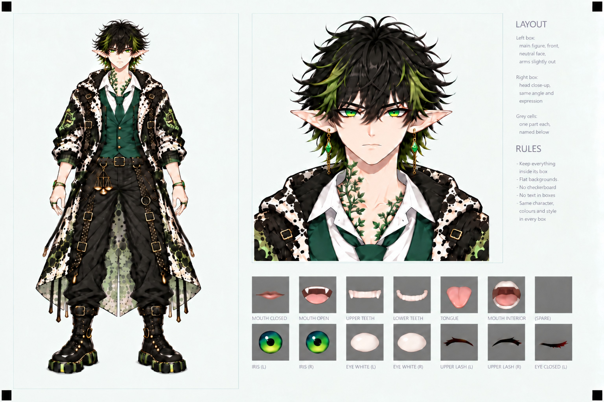
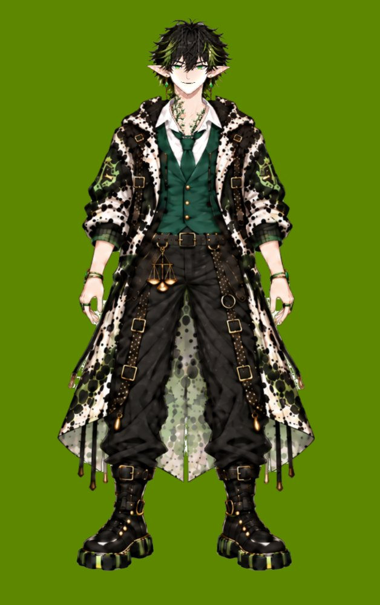
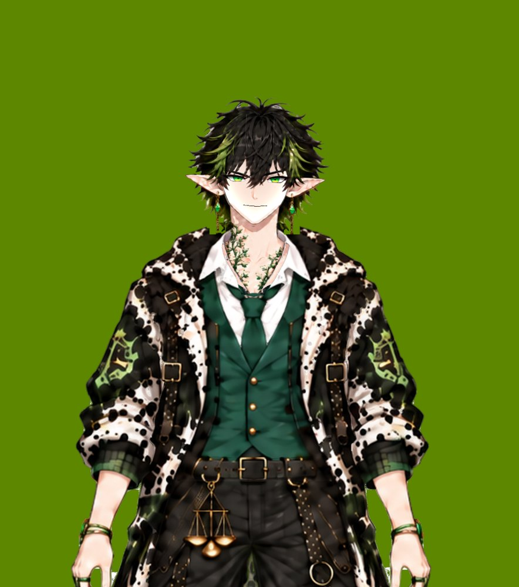
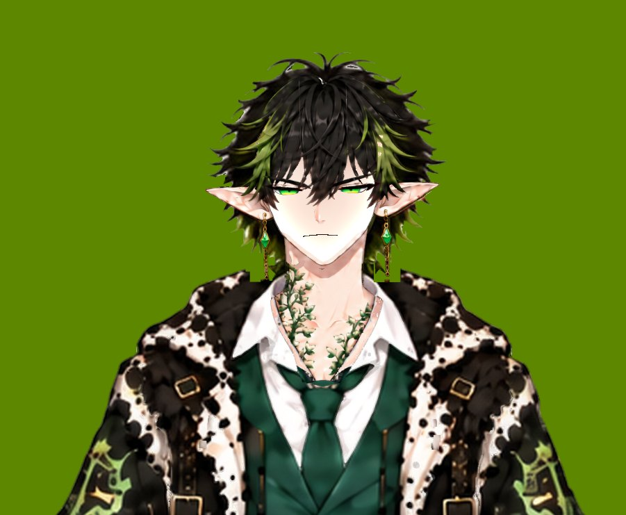
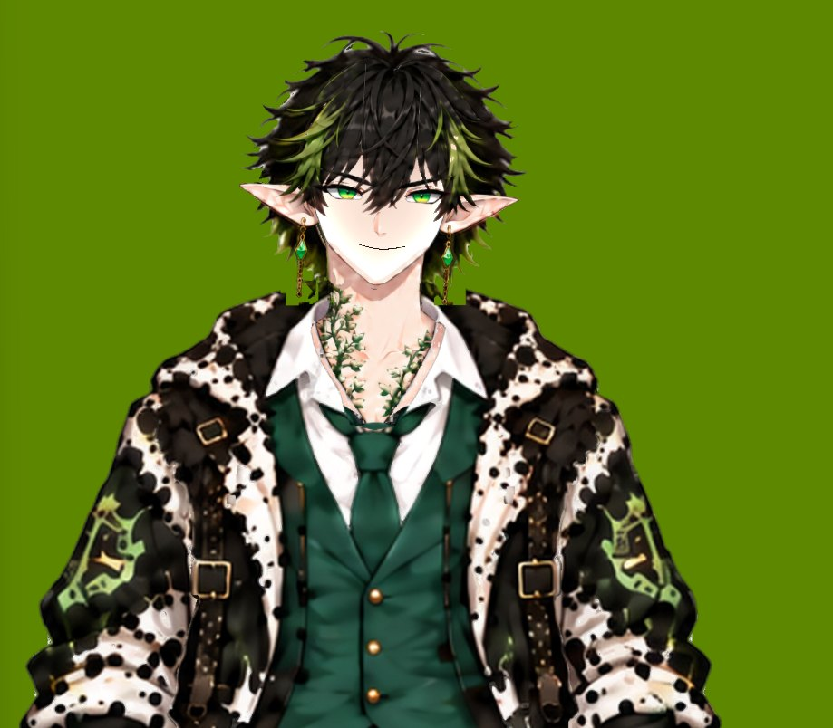
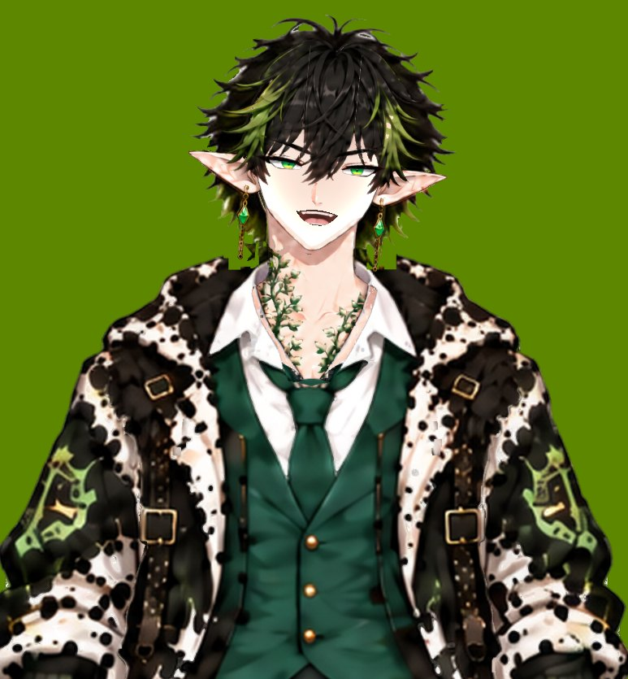
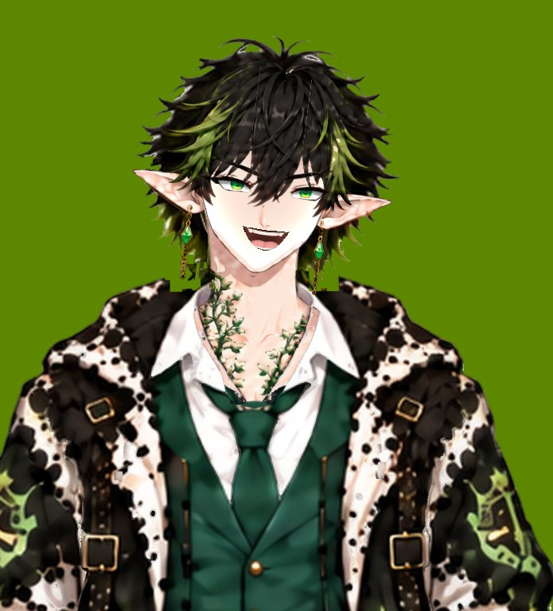
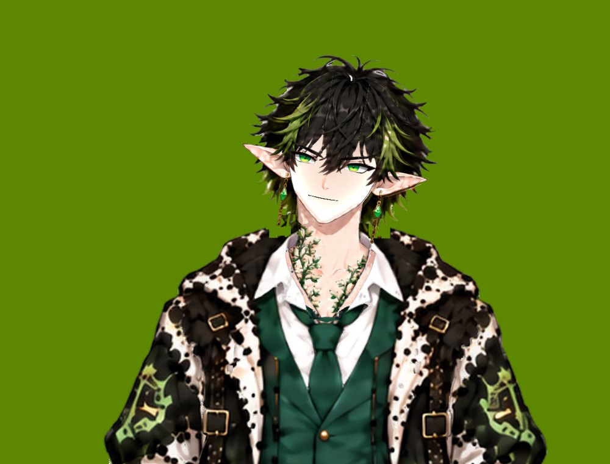
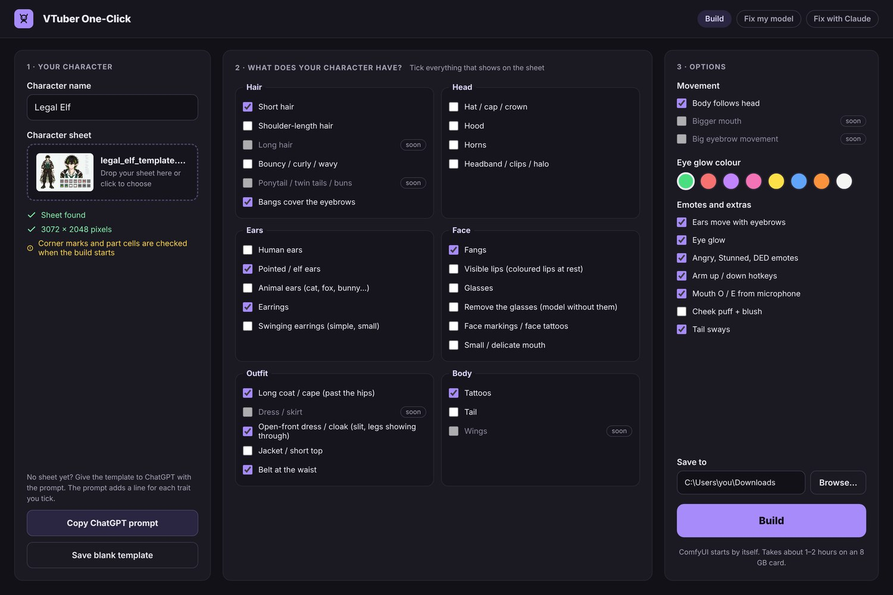
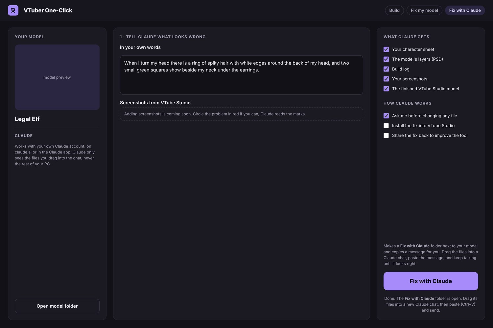

# Vtuber 1-Click 2D Model Creator

Turn one picture of your character into a moving VTuber model for **VTube Studio**. No rigging skills needed.

## Example: Legal Elf

The sheet above, built with this tool and running in VTube Studio:

> Status: **alpha**. It works, but expect some rough edges. Long hair, ponytails, dresses and wings are not supported yet. See what's new in the **[changelog](CHANGELOG.md)**.

---

## What you need

- A Windows 10 or 11 PC
- An **NVIDIA graphics card with 8 GB or more** (for example an RTX 3060, 3070 or 4060)
- About **30 GB of free space**
- An internet connection for the first setup

## Step 1: Install

1. Download **VTuber One-Click Setup.exe**.
2. Double-click it and click **Next**.
3. Pick a folder (the suggested `C:\VTuberOneClick` is fine) and click **Install**.
4. Wait about 10 to 20 minutes while it downloads everything. Then click **Finish**.

You now have a **VTuber One-Click** icon on your Desktop.

## Step 2: Make your character sheet

The app needs one picture laid out in a special way, called a **character sheet**.

*The app. Tick what your character has (middle column), then click **Copy ChatGPT prompt** (bottom left).*

1. Download the blank template: **[VTuber_Sheet_Template_BLANK.png](examples/VTuber_Sheet_Template_BLANK.png)**
   (the app's **Save blank template** button gives you the same file).
2. Look at the finished example so you know what to aim for: **[Legal_Elf_Template.jpg](examples/Legal_Elf_Template.jpg)**
3. Give the blank template to an image AI (for example ChatGPT) together with a picture of your character.
   In the app, tick what your character has, then click **Copy ChatGPT prompt** and paste that prompt in.
4. Save the result. It should look like the example:
   - **Left box:** your character's whole body, facing front, arms slightly out
   - **Right box:** a close-up of the head, same face
   - **Grey boxes:** the mouth, teeth, tongue, eyes and eyebrows, one in each box
   - The four **black squares in the corners** must still be there
   - Best size: **3072 x 2048** pixels (any 3:2 picture works, bigger is better)

## Step 3: Build your model

1. Double-click **VTuber One-Click** on your Desktop. It opens in your web browser.
2. Type your character's **name**.
3. Click the sheet box and choose your character sheet.
4. Tick everything your character has (hair, ears, horns, coat, tail...).
5. Choose where to save the model, then click **Build**.

A black **ComfyUI** window opens. Leave it open. Building takes **1 to 2 hours** on an 8 GB card, and the
very first build also downloads the AI models (about 13 GB). When it is done, the app tells you where your model zip is.

## Step 4: Use it in VTube Studio

1. Unzip the model zip.
2. Put the folder inside VTube Studio's `Live2DModels` folder
   (in Steam: right-click VTube Studio > Manage > Browse local files > `VTube Studio_Data\StreamingAssets\Live2DModels`).
3. Open VTube Studio and pick your model.

Your model comes with blinking, mouth movement, head turns, hair physics and expressions
(Eye Glow, Angry, Stunned, DED) that you can put on hotkeys.

## Something looks wrong? Fix it with Claude

### Steps

1. Open the app and click the **Fix with Claude** tab (top right).
2. Under **Tell Claude what looks wrong**, describe the problem in your own words.
   For example: *"When I turn my head there is a ring of spiky hair with white edges around the back of my head."*
3. Leave the boxes under **What Claude gets** ticked and click **Fix with Claude**.
4. A **Fix with Claude** folder opens (it is saved in your model's build folder), and a message is copied for you.
5. Open a new chat at [claude.ai](https://claude.ai) or in the Claude app and drag in **all the files** from that folder.
6. Paste the message (**Ctrl+V**) and send. Keep chatting until it looks right.

The folder includes a short project brief, so Claude already knows how the tool works, what usually goes wrong
and how to rebuild quickly. You need your own Claude account (any plan). Claude only sees the files you drag into
the chat, and your current model is never changed.

Full guide with tips and troubleshooting: **[How to fix your model with Claude](FIX_WITH_CLAUDE.md)**

### All other problems

For anything Fix with Claude can't solve, or a problem with the app itself (installing, building, the app not
opening), please report it on the **[Issues page](https://github.com/legalelfVT/Vtuber-1-Click-2D-Model-Creator/issues)**.
Click **New issue**, say what happened and what you expected, and attach a screenshot and your build log
(`output\<name>_build_log.txt` in your install folder) if you have them.

## Tips

- Clean, simple drawings work best: front view, plain background, no text inside the boxes.
- Draw the open mouth smaller than its grey box, with space around it.
- If something looks wrong, build again with a better sheet. The app keeps your old model.

## Uninstall

Windows **Settings > Apps > Installed apps > VTuber One-Click > Uninstall**.

---

## How it works

Reference sheet > ComfyUI with [See-through](https://github.com/jtydhr88/ComfyUI-See-through) (splits the picture
into layers) > [PSD2Live](https://github.com/tsunehimatoi/psd2live) 3.4.5 (rigs the layers) > a VTube Studio model zip.

## License

This project's own code is MIT (see `LICENSE`). Setup downloads ComfyUI and PSD2Live from their official pages;
they are GPL-3.0 and are not included here. The AI models have their own licenses.
